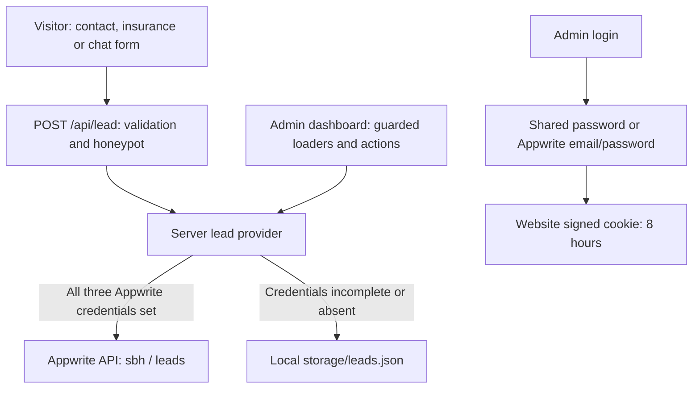

# System architecture

The provider is chosen at module initialization, so configuration changes require a restart. A configured Appwrite outage returns a submission error rather than silently switching to the file store.

SSR is enabled in `react-router.config.ts`. Server loaders/actions handle persistence and admin access. `.server.ts` modules hold backend credentials. Content is supplied through `app/data/`; there is no external CMS in the reviewed implementation.

Deployment has two independent components: the Node website process and an optional Appwrite service. A website Docker image does not install Appwrite. See [[../03-Integrations/Appwrite|Appwrite]] and [[Data-and-Lead-Lifecycle]].
